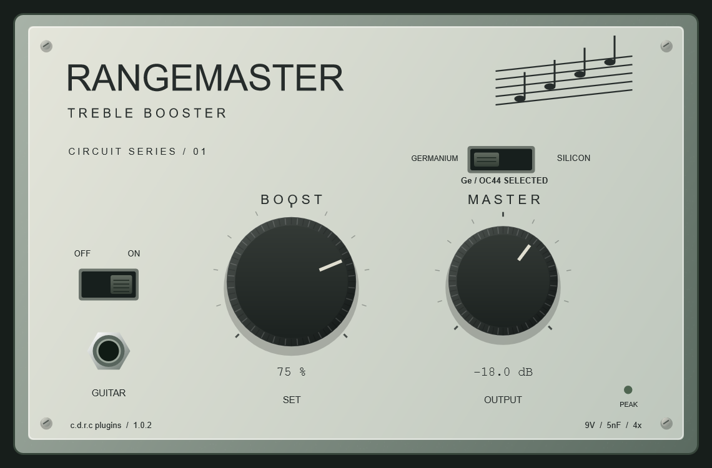

# RangeMaster — c.d.r.c plugins

**Автор и производитель: c.d.r.c plugins. Версия 1.0.2.**

VST3/AU-проект Treble Booster на основе схемы Dallas Rangemaster: германиевый режим OC44, кремниевая замена транзистора в той же схеме, исходный Boost и дополнительный Master. Имя плагина в DAW: **c.d.r.c plugins - RangeMaster**.



## Скачать и установить

Готовая проверенная сборка для Windows x64: **[скачать VST3 и standalone](downloads/cdrc-RangeMaster-1.0.2-Windows-x64.zip)**.

1. Распакуйте архив.
2. Скопируйте **всю папку** `c.d.r.c plugins - RangeMaster.vst3` в `C:\Program Files\Common Files\VST3` либо в пользовательский VST3-каталог, поддерживаемый вашей DAW. Для системного каталога могут потребоваться права администратора.
3. Выполните повторное сканирование плагинов в DAW и добавьте **c.d.r.c plugins - RangeMaster** на дорожку.
4. Проверьте подпись **c.d.r.c plugins / 1.0.2** внизу интерфейса. У предыдущих выпусков другое имя файла и производителя; удалите старый экземпляр с дорожки, если хотите открыть новый.

`c.d.r.c plugins - RangeMaster.exe` — отдельное приложение для запуска без DAW. Выберите вход и выход аудиоинтерфейса в настройках аудио приложения.

**AU работает только на macOS.** В репозитории есть исходники и универсальный скрипт сборки AU/VST3 для arm64 + x86_64. Локально собрана и проверена Windows-версия; готовый проверенный macOS AU здесь не заявляется. Автоматические сборки доступны во вкладке [Actions](https://github.com/Vmpyre47/Treble-booster-VST/actions), если соответствующий запуск завершился успешно.

## Как пользоваться

Для сухой электрогитары DI типичная цепочка: **DI → RangeMaster → гитарный усилитель → кабинет/IR**. Сам плагин не включает усилитель или кабинет.

| Управление | Что делает |
|---|---|
| Boost | Исходный логарифмический коллекторный потенциометр 10 кОм. Вправо — громче, полностью влево — тишина. Это преимущественно выходной регулятор, а не отдельный Input Drive. |
| Master | Уровень после схемы, от -60 до +6 дБ; по умолчанию -18 дБ. Не меняет входной уровень транзистора. |
| Germanium / Silicon | Выбирает модель транзистора. Пассивные номиналы остаются одинаковыми. Под переключателем показан выбранный режим. |
| Off / On | Плавно отключает/включает обработку. Задержка оверсэмплинга сохраняется в Off. |
| Peak | Красный при выходе за 0 dBFS. Выходного лимитера нет. |

Начальные настройки: Germanium, Boost 75–100%, Master -18 дБ, On. Поднимайте Master по необходимости, контролируя выходной уровень. Логарифмический Boost и Master вместе могут сильно уменьшать громкость. Двойной щелчок по ручке возвращает значение по умолчанию.

Параметры автоматизируются и сохраняются в проекте DAW. Поддерживаются моно и стерео; оверсэмплинг фиксированный 4×, задержка проверенной Windows-сборки — 6 сэмплов.

## Сборка Windows

Нужны CMake 3.22+, Visual Studio с компонентом **Desktop development with C++**, Windows SDK и доступ к интернету для загрузки JUCE 8.0.12. Версия и SHA256 архива JUCE закреплены в CMake.

```powershell
git clone https://github.com/Vmpyre47/Treble-booster-VST.git
cd Treble-booster-VST
./scripts/build-windows.ps1
```

Результаты: `build/RangeMasterLab_artefacts/Release/VST3/` и `build/RangeMasterLab_artefacts/Release/Standalone/`.

Если JUCE уже скачан, можно настроить сборку вручную: `cmake -S . -B build -DJUCE_PATH="C:/path/to/JUCE-8.0.12"`, затем `cmake --build build --config Release`.

## Сборка macOS: AU и VST3

Нужны Xcode с Command Line Tools, CMake и интернет для JUCE.

```bash
git clone https://github.com/Vmpyre47/Treble-booster-VST.git
cd Treble-booster-VST
bash scripts/build-macos.sh
```

Скрипт собирает universal arm64 + x86_64, запускает тесты, создаёт локальную ad-hoc подпись и помещает `.component` и `.vst3` в `dist/`. Подпись Developer ID и нотариализация Apple не предусмотрены.

Установка Mac: скопируйте `.component` в `~/Library/Audio/Plug-Ins/Components/`, `.vst3` — в `~/Library/Audio/Plug-Ins/VST3/`, затем перезапустите DAW. Для проверки установленного AU:

```bash
auval -v aufx RmLb CdrC
```

## Проверки и точность модели

Стенд включает 65 проверок: устойчивость при перегрузе, частоты 44,1–192 кГц, разные размеры блока, стерео, Master, сохранение состояния, клики Ge/Si и автоматизацию. Дополнительно используется pluginval strictness 5. Результаты Windows — в `test-results/`.

Решатель схемы независимо сопоставлен с ngspice. После перехода на трапецеидальный расчёт конденсаторов в 1.0.1 относительная RMS-ошибка на выбранных тестах сильного перегруза составила 0,18–0,36%. Подробности: [проверка схемы и управления](CONTROL_AUDIT.md), [отчёт](TEST_REPORT.md), [модель и источники схемы](CIRCUIT.md).

**Это номинальная схемная модель.** Параметры конкретного физического OC44 не измерялись; взаимодействие с пассивным звукоснимателем и кабелем не моделируется. Сравнение со SPICE проверяет реализацию выбранных уравнений и не доказывает точное совпадение звучания с реальной педалью. Кремниевый режим и Master — дополнения к оригиналу.

## Лицензия

Copyright © 2026 **c.d.r.c plugins**. Код проекта распространяется по **GNU AGPLv3** — см. [LICENSE.txt](LICENSE.txt). JUCE используется по варианту AGPLv3; его исходники загружаются из закреплённого upstream-архива. Сведения о сторонних компонентах: [THIRD_PARTY.md](THIRD_PARTY.md).

Dallas, Rangemaster и OC44 указаны как названия прототипа и компонента; проект не связан с производителями оригинала.
